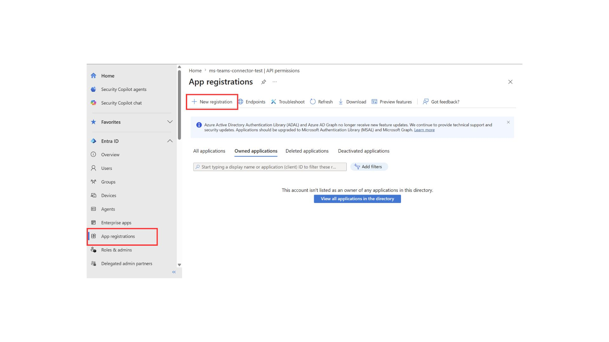
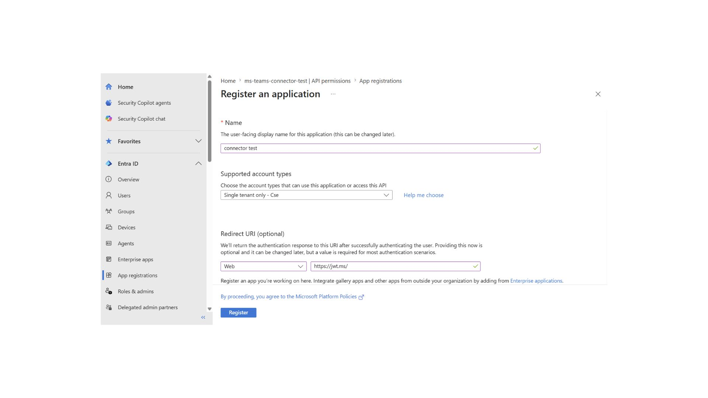
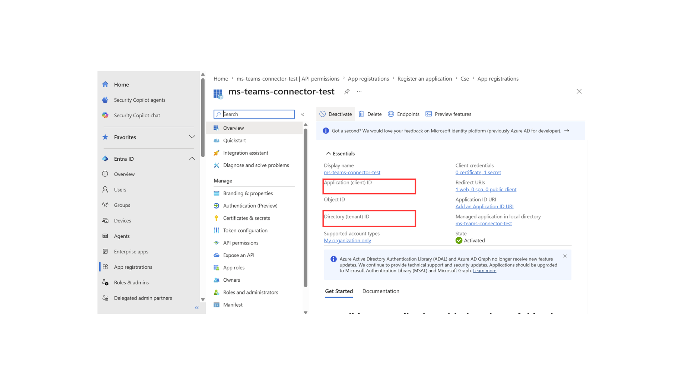
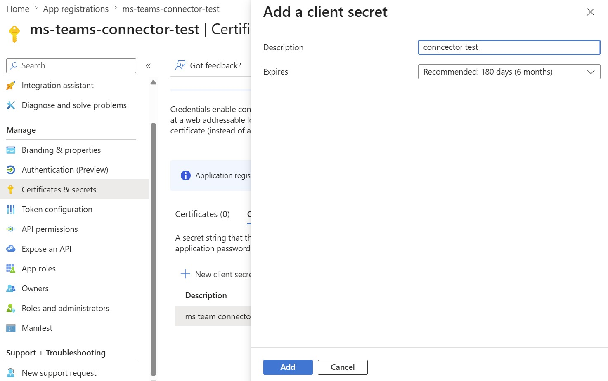
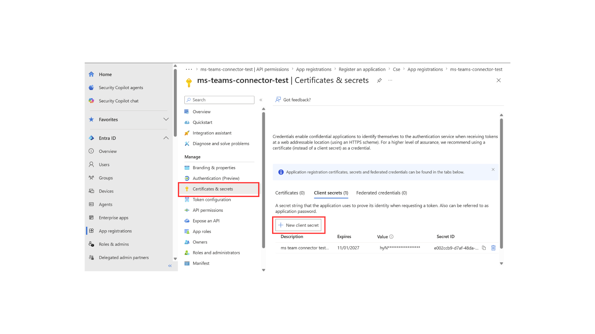

# Ballerina Azure Data Lake connector

[](https://github.com/ballerina-platform/module-ballerinax-azure.datalake/actions/workflows/ci.yml)
[](https://github.com/ballerina-platform/module-ballerinax-azure.datalake/commits/master)
[](https://github.com/ballerina-platform/ballerina-library/labels/module%2Fazure.datalake)

## Overview

[Azure Data Lake Storage](https://learn.microsoft.com/en-us/azure/storage/blobs/data-lake-storage-introduction) is Microsoft Azure's storage for big data analytics. It adds a hierarchical namespace to Azure Blob Storage, so that data is organized in filesystems, directories and files with POSIX-style permissions and access control lists, and can be used by Hadoop, Spark and other analytics workloads.

The Azure Data Lake connector lets Ballerina programs work with Data Lake Storage through its REST API, version 2019-10-31. It covers filesystems in a storage account, and the files and directories inside them: creating, renaming, listing and deleting paths, uploading and reading file content, managing properties and access control, and leasing files for exclusive access.

## Setup guide

To use the Azure Data Lake connector, you need an Azure subscription, a storage account with a hierarchical namespace, and an application registered in Microsoft Entra ID. The connector calls the storage account on behalf of a signed-in user, so that user also needs a data-plane role on the account.

> **Note:** The screenshots in this guide are for illustration only. The Microsoft Entra admin center changes over time, so treat them as a visual reference rather than an exact match — follow the described actions and choose the values (application name, redirect URI, permissions, and so on) that fit your own scenario.

### Step 1: Create a storage account with hierarchical namespace

1. Sign in to the [Azure portal](https://portal.azure.com/) with an account that has an active subscription.
2. Search for **Storage accounts** and select **Create**.
3. Choose a subscription, resource group, region and a globally unique account name.
4. On the **Advanced** tab, select **Enable hierarchical namespace**.
5. Create the account.
6. Note the account's Data Lake endpoint, `https://<storage-account-name>.dfs.core.windows.net`. The connector sends every request to this URL.

### Step 2: Grant data-plane access

1. Open the storage account's **Access control (IAM)** page and select **Add** > **Add role assignment**.
2. Assign one of the following roles to the user account that will sign in during Step 6:

   | Role | Purpose |
   |---|---|
   | **Storage Blob Data Reader** | Read filesystems, directories and files — sufficient for read-only integrations |
   | **Storage Blob Data Contributor** | Read and write data |
   | **Storage Blob Data Owner** | Also change owners, permissions and access control lists |

   Management roles such as **Owner** or **Contributor** on the account don't grant access to its data. A new role assignment can take up to 30 minutes to take effect.

### Step 3: Register an application in Microsoft Entra ID

1. Sign in to the [Microsoft Entra admin center](https://entra.microsoft.com).
2. Navigate to **Entra ID** > **App registrations** and click **New registration**.

   

3. Enter a name of your choice and select the account types appropriate for your organization. Add a **Redirect URI** under the **Web** platform — this is where the sign-in flow returns the authorization code (a Microsoft-hosted page such as `https://jwt.ms` is a convenient choice for Step 6). The **Web** platform is required because the connector redeems the code using a client secret; the public "Mobile and desktop applications" platform does not accept one. Click **Register**.

   

4. On the app's **Overview** page, note the **Application (client) ID** and the **Directory (tenant) ID** — you need both for `Config.toml`, and the tenant ID to build the token endpoint in Step 6.

   

### Step 4: Add the Azure Storage permission

1. In the registered application, go to **API permissions** > **Add a permission** and select **Azure Storage** from the **Microsoft APIs** tab.
2. Choose **Delegated permissions**, select `user_impersonation` (access Azure Storage as the signed-in user), and click **Add permissions**.

   The permission lets the application take any action the signed-in user is allowed to, so what the connector can do is limited by the user's role from Step 2. The `offline_access` scope, which returns a refresh token, is requested at sign-in in Step 6 and doesn't need to be added here.

3. If your organization requires admin consent, click **Grant admin consent for \<your tenant\>** on the **API permissions** page and confirm **Yes**.

### Step 5: Create a client secret

1. Go to **Certificates & secrets** > **New client secret**, add a description and an expiry, and click **Add**.

   

2. Copy the secret **Value** immediately — it is shown only once. (The **Secret ID** next to it is just a label, not a credential.)

   

### Step 6: Obtain a refresh token

Replace `<TENANT_ID>`, `<CLIENT_ID>`, and `<CLIENT_SECRET>` below with the values from Steps 3 and 5. Use your directory (tenant) ID for a single-tenant application, or `common` for a multi-tenant one.

**1. Get an authorization code.** This is an interactive sign-in and consent step, so it cannot be curled — paste this URL into a browser instead, and sign in with the user account that has the role from Step 2:

```text
https://login.microsoftonline.com/<TENANT_ID>/oauth2/v2.0/authorize?client_id=<CLIENT_ID>&response_type=code&redirect_uri=https%3A%2F%2Fjwt.ms&response_mode=query&scope=https%3A%2F%2Fstorage.azure.com%2Fuser_impersonation%20offline_access&state=12345
```

Accept the consent prompt. You land on `https://jwt.ms/?code=<AUTH_CODE>&state=12345` — copy the `code` value from that URL. It is single-use and short-lived, so use it within a few minutes.

**2. Exchange the code for a refresh token.**

macOS / Linux:

```bash
curl -X POST "https://login.microsoftonline.com/<TENANT_ID>/oauth2/v2.0/token" \
  --data-urlencode "client_id=<CLIENT_ID>" \
  --data-urlencode "client_secret=<CLIENT_SECRET>" \
  --data-urlencode "scope=https://storage.azure.com/user_impersonation offline_access" \
  --data-urlencode "code=<AUTH_CODE>" \
  --data-urlencode "redirect_uri=https://jwt.ms" \
  --data-urlencode "grant_type=authorization_code"
```

Windows (PowerShell — call `curl.exe` explicitly; plain `curl` is aliased to `Invoke-WebRequest` and takes different flags):

```powershell
curl.exe -X POST "https://login.microsoftonline.com/<TENANT_ID>/oauth2/v2.0/token" `
  --data-urlencode "client_id=<CLIENT_ID>" `
  --data-urlencode "client_secret=<CLIENT_SECRET>" `
  --data-urlencode "scope=https://storage.azure.com/user_impersonation offline_access" `
  --data-urlencode "code=<AUTH_CODE>" `
  --data-urlencode "redirect_uri=https://jwt.ms" `
  --data-urlencode "grant_type=authorization_code"
```

The JSON response includes a `refresh_token` field — that is the `refreshToken` value for `Config.toml`. The connector refreshes against the same token endpoint you just called, `https://login.microsoftonline.com/<TENANT_ID>/oauth2/v2.0/token`.

> The `access_token` in the same response is short-lived (about an hour) and is not used directly; the connector uses the refresh token to mint new access tokens automatically.

## Quickstart

To use the Azure Data Lake connector in your Ballerina application, update the `.bal` file as follows:

### Step 1: Import the module

Import the `azure.datalake` module.

```ballerina
import ballerinax/azure.datalake;
```

### Step 2: Instantiate a new connector

Create a `datalake:Client` with the storage account's Data Lake endpoint and the credentials from Steps 3, 5 and 6 of the setup guide.

```ballerina
configurable string storageAccount = ?;
configurable string tenantId = ?;
configurable string clientId = ?;
configurable string clientSecret = ?;
configurable string refreshToken = ?;

final datalake:Client datalake = check new ({
    auth: {
        clientId,
        clientSecret,
        refreshToken,
        refreshUrl: string `https://login.microsoftonline.com/${tenantId}/oauth2/v2.0/token`,
        scopes: ["https://storage.azure.com/user_impersonation", "offline_access"]
    }
}, string `https://${storageAccount}.dfs.core.windows.net`);
```

> **Note:** The connector's default token URL is the multi-tenant `https://login.microsoftonline.com/common/oauth2/v2.0/token` endpoint. It works only for applications that accept accounts from any organization, so change it to your tenant's endpoint, as `refreshUrl` does above.

Provide the values in a `Config.toml` file:

```toml
storageAccount = "<storage-account-name>"
tenantId = "<tenant-id>"
clientId = "<client-id>"
clientSecret = "<client-secret>"
refreshToken = "<refresh-token>"
```

### Step 3: Invoke the connector operation

List the filesystems in the storage account.

```ballerina
public function main() returns error? {
    datalake:FilesystemList _ = check datalake->listFilesystems();
}
```

### Step 4: Run the Ballerina application

```bash
bal run
```

## Examples

The `Azure Data Lake` connector provides practical examples illustrating usage in various scenarios. Explore these [examples](https://github.com/ballerina-platform/module-ballerinax-azure.datalake/tree/main/examples/), covering the following use cases:

1. [Daily extract ingestion](https://github.com/ballerina-platform/module-ballerinax-azure.datalake/tree/main/examples/daily_extract_ingestion) - Upload a local extract into a dated directory in chunks, then list the directory and read the file back.

## Build from the source

### Setting up the prerequisites

1. Download and install Java SE Development Kit (JDK) version 21. You can download it from either of the following sources:

    * [Oracle JDK](https://www.oracle.com/java/technologies/downloads/)
    * [OpenJDK](https://adoptium.net/)

   > **Note:** After installation, remember to set the `JAVA_HOME` environment variable to the directory where JDK was installed.

2. Download and install [Ballerina Swan Lake](https://ballerina.io/).

3. Download and install [Docker](https://www.docker.com/get-started).

   > **Note**: Ensure that the Docker daemon is running before executing any tests.

4. Export Github Personal access token with read package permissions as follows,

    ```bash
    export packageUser=<Username>
    export packagePAT=<Personal access token>
    ```

### Build options

Execute the commands below to build from the source.

1. To build the package:

   ```bash
   ./gradlew clean build
   ```

2. To run the tests:

   ```bash
   ./gradlew clean test
   ```

3. To build the without the tests:

   ```bash
   ./gradlew clean build -x test
   ```

4. To run tests against different environments:

   ```bash
   ./gradlew clean test -Pgroups=<Comma separated groups/test cases>
   ```

5. To debug the package with a remote debugger:

   ```bash
   ./gradlew clean build -Pdebug=<port>
   ```

6. To debug with the Ballerina language:

   ```bash
   ./gradlew clean build -PbalJavaDebug=<port>
   ```

7. Publish the generated artifacts to the local Ballerina Central repository:

    ```bash
    ./gradlew clean build -PpublishToLocalCentral=true
    ```

8. Publish the generated artifacts to the Ballerina Central repository:

   ```bash
   ./gradlew clean build -PpublishToCentral=true
   ```

## Contribute to Ballerina

As an open-source project, Ballerina welcomes contributions from the community.

For more information, go to the [contribution guidelines](https://github.com/ballerina-platform/ballerina-lang/blob/master/CONTRIBUTING.md).

## Code of conduct

All the contributors are encouraged to read the [Ballerina Code of Conduct](https://ballerina.io/code-of-conduct).

## Useful links

* For more information go to the [`azure.datalake` package](https://central.ballerina.io/ballerinax/azure.datalake/latest).
* For example demonstrations of the usage, go to [Ballerina By Examples](https://ballerina.io/learn/by-example/).
* Chat live with us via our [Discord server](https://discord.gg/ballerinalang).
* Post all technical questions on Stack Overflow with the [#ballerina](https://stackoverflow.com/questions/tagged/ballerina) tag.
